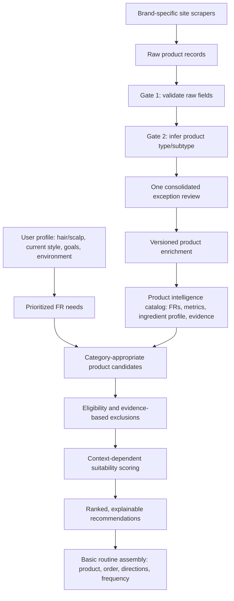

# CurlCode — High-Level Architecture (v0.1)

**Status:** Draft, to validate against product data · 2026-11-17  
**Canonical source:** This file in GitHub. Linear issues should link here, not maintain a second editable copy.

## Objective

CurlCode maps user concerns and hair context to functional requirements (FR01–FR29), classifies what products plausibly do, then dynamically scores product suitability for that user and current hairstyle. Manufacturer claims are evidence, not ground truth.

## End-to-end architecture

## Product pipeline

1. **Extract** five source fields — `name`, `url`, `description`, `directions`, `ingredients` — using a different scraper adapter per brand/site. Keep raw source text, URL, extraction date, adapter version; infer brand from domain/site context.
2. **Gate 1, automatic:** flag missing/implausible fields, malformed ingredient lists, content in the wrong field, extraction artifacts, and duplicates.
3. **Gate 2, automatic:** infer type/subtype/form, flag ambiguous or conflicting classes.
4. **One manual review queue:** inspect exceptions from both gates together, not all records twice. Critical raw-data issues block enrichment; sample auto-approved records to calibrate validation. Preserve overrides.
5. **Enrich:** assign FR candidates from product claims, constrain them by product type/subtype/use, compare with high-impact ingredient evidence, and record supported/qualified/contradicted/unresolved decisions. Infer ingredient profile and metrics with evidence confidence; version the rules. Re-run enrichment when reviewed fields change.

Reuse valid raw datasets even if previously enriched by older scripts; regenerate derived fields rather than scraping them again unnecessarily.

## Product intelligence

The authoritative FR01–FR29 definitions describe **mechanisms**, not free-form marketing tags. Use `docs/product/CurlCode_Recommendation_Engine_Tables.xlsx` (especially `HairMechanisms` and `ProductCategories`) as the starting point for the category/FR eligibility matrix. Allow ingredients to challenge claims but do not assume an ingredient's mere presence proves or disproves performance.

Retain the existing `weight`, `protein_level`, `hold_level`, `slip_level`, `occlusiveness`, `film_forming`, and `humectant_level` metrics. Add evidence provenance and confidence; **confidence in evidence is not validated performance confidence**. Ingredient order and contact time provide useful context but do not reveal concentrations or actual product behavior.

## User intelligence and recommendation

User hair characteristics, scalp, existing hairstyle, needs, preferences, and environment determine prioritized FRs. Retrieve appropriate candidates, apply reliable incompatibility constraints, then calculate a **dynamic suitability score** for this user in this context. FR matches alone do not determine ranking. Return explanations and limitations.

## Routine intelligence

Assemble a basic routine using recommended products, categories, application directions, frequency and appropriate cleansing/conditioning considerations. Film-former presence alone does **not** prove buildup, poor removability, or unsuitable daily use.

## MVP scope

**Now:** shared raw schema, site adapters, automated validations, one exception-review queue, typed products, explainable FR/ingredient enrichment, heuristic metrics and evidence, basic contextual suitability and simple routines.

**Later:** quantitative ingredient interaction modeling, buildup accumulation prediction, automated learning from usage histories, laboratory-like performance claims.

## Existing documents

- [Product intelligence specification](./product-intelligence.md) — detailed pipeline, inference and testing rules.
- [Backend SDS](../product/Hair_Care_Recommendation_Platform_SDS_Final_v1.1.docx) — broader than current MVP.
- [FR/recommendation source workbook](../product/CurlCode_Recommendation_Engine_Tables.xlsx) — authoritative mapping including ProductCategories, StyleMechanisms, InputModifiers, ConflictRules.
- [ADR 0001](../decisions/0001-ground-evaluation-engine-in-real-fr-data.md) — present MVP evaluation simplifications.
- Frontend UX specification stays separate: user-facing screens and presentation; business logic belongs to the backend.

## Next decisions

1. Reconcile FR × type/subtype eligibility with the ProductCategories sheet and real test cases.
2. Specify evidence and confidence per metric.
3. Inventory previously scraped/enriched brand datasets, normalize raw fields, and version reprocessing.
4. Implement and test the validator/review/enrichment pipeline.

**Linear tracking:** CUR-63 (architecture), CUR-64 (FR taxonomy), CUR-65 (user-to-FR), CUR-66 (matching), CUR-67 (testing).
